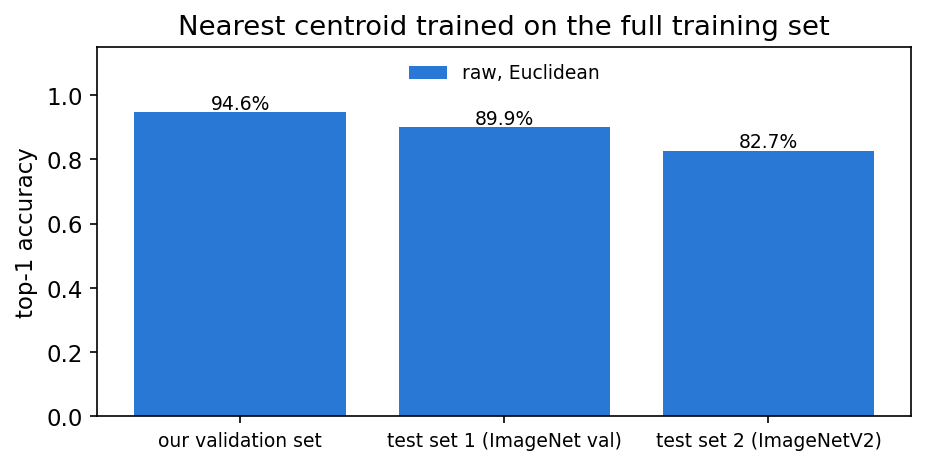

# 4.3 Classifier C: Nearest centroid

Code: `code/03_nearest_centroid.py`. Results: `data/output/ncm_*.csv`. Figures: `data/output/fig_ncm_*.png`.

## Method

For each of the 1,000 classes, we take the mean of its training feature vectors. This mean is the class centroid.
To classify an image, we find the centroid closest to its feature vector and give the image that class.

We chose this method because it is very different from classifiers A and B. It has no weights to learn, so there is
nothing to tune with gradient descent. Training is just adding up the features of each class, so the full training
set can be read once, in chunks, from the memory-mapped file.

## How we chose the variant

We tried 29 variants. Each one was trained on `train_small` (100 images per class) and scored on our validation set.
The test sets were not used for this.

The baseline is the plainest version: raw features and Euclidean distance. The variants were:

| Experiment | What we changed | Variants |
|---|---|---|
| E1 | Normalisation of the features | standardised, cosine, centred + cosine, standardised + cosine |
| E2 | Number of dimensions (PCA) | 32 to 1,024 components, with and without whitening |
| E3 | Distance measure (LDA) | shared within-class covariance, shrinkage 0.01 to 1 |
| E4 | Amount of training data | 2 to 100 images per class, and the full training set |

Our validation set has 50,000 images, so one top-1 accuracy has a standard error of about 0.1 percentage points.
We picked the simplest variant whose top-1 accuracy was within one standard error of the best one. This rule is
conservative: two models scored on the same images differ by less noise than this, so we may treat a real but very
small difference as noise.

## Results on our validation set

| Variant | Top-1 accuracy |
|---|---|
| Baseline (raw, Euclidean) | 94.64% |
| E1 normalisation | 94.62% to 94.64% |
| E2 PCA, 256 to 1,024 components | 94.54% to 94.67% |
| E2 PCA, 32 components | 93.04% |
| E3 LDA | 94.42% to 94.54% |

- **E1:** All normalisations gave the same accuracy as the raw features (Figure 1).
- **E2:** PCA with 256 or more components gave the same accuracy as all 1,024 features. With fewer components the
  accuracy dropped (Figure 2). Whitening did not help.
- **E3:** LDA was a little worse than the plain Euclidean distance. It got closer to the baseline as the shrinkage
  went up to 1, which means no LDA (Figure 3).
- **E4:** With only 2 images per class the accuracy was already 92.9%. After about 25 images per class it stopped
  improving (Figure 4).

The best variant was PCA with 256 components (94.67%). It was only 0.03 points above the baseline, which is less than
one standard error (0.10). So we kept the baseline as the final model.

*Figure 1. E1: top-1 accuracy on our validation set for each normalisation.*

*Figure 2. E2: top-1 accuracy on our validation set against the number of PCA components.*

*Figure 3. E3: top-1 accuracy on our validation set against the LDA shrinkage (1 = no LDA).*

*Figure 4. E4: top-1 accuracy on our validation set against the number of training images per class.*

## Final results

The final model (raw features, Euclidean distance) was trained on the full training set, without the rows of our
validation set (1,231,167 images). It was then scored once on each test set.

| Set | Images | Top-1 accuracy | Top-5 accuracy |
|---|---|---|---|
| Our validation set | 50,000 | 94.6% | 99.6% |
| Test set 1 (ImageNet val) | 50,000 | 89.9% | 98.8% |
| Test set 2 (ImageNetV2) | 10,000 | 82.7% | 96.1% |

Top-1 accuracy on test set 2 is 7.3 points lower than on test set 1. Section 5 looks at why.

Training on the full training set took 174 seconds (about 3 minutes) on a laptop CPU. Predicting the 50,000 images of test set 1
took about 3 seconds.

*Figure 5. Top-1 accuracy of the final model on our validation set and both test sets.*

## What we found

- The EVA-02 features already work well with a simple distance. Normalisation, PCA and LDA did not make them better.
- A few images per class are enough to place a good centroid.
- Even this simple classifier has a gap of 7.3 points between the two test sets.

## Lessons learnt (Trung, for section 7)

1. Good pretrained features do most of the work. A very simple classifier on EVA-02 features came within about
   0.1 points of the best variant we tried.
2. When results differ by less than the noise, pick the simplest model. Many of our variants looked different but
   were not really better.
3. For a very large dataset, a method that only needs sums can be trained in one pass over the data, without loading
   it all into memory.
